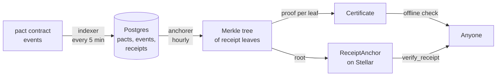

<p align="center">
  <picture>
    <source media="(prefers-color-scheme: dark)" srcset="brand/pactwright-logo-dark.svg">
    
  </picture>
</p>

<p align="center">
  <b>Where every pact becomes visible and provable.</b><br>
  Public pact timelines, verifiable receipts, and dashboards for sellers and agent owners.
</p>

<p align="center">
  <a href="https://github.com/Pactwright/Pactwright-studio/actions/workflows/ci.yml"></a>
  <a href="#what-works-today"></a>
  <a href="https://github.com/Pactwright/Pactwright-contracts"></a>
  <a href="#license"></a>
</p>

<p align="center">
  <a href="#in-60-seconds"><b>In 60 seconds</b></a> ·
  <a href="#how-a-receipt-becomes-provable"><b>How a receipt becomes provable</b></a> ·
  <a href="#what-works-today"><b>What works today</b></a> ·
  <a href="#run-it-locally"><b>Run it locally</b></a> ·
  <a href="#license"><b>License</b></a> ·
  <a href="https://github.com/Pactwright/Pactwright-contracts">Contracts</a> ·
  <a href="https://github.com/Pactwright/Pactwright-Kit">Kit</a>
</p>

<p align="center">
  <a href="https://scorecard.dev/viewer/?uri=github.com/Pactwright/Pactwright-studio"></a>
</p>

> [!IMPORTANT]
> **Not deployed yet.** The pages, API, indexer and anchorer logic run locally and are tested
> against Postgres and fixture data. Two connections to the chain are still stubs: reading events
> from Stellar RPC, and submitting `anchor_batch` transactions. Until they land, Studio shows
> seeded data rather than live testnet pacts. [What works today](#what-works-today) has the details.

## Contents

1. [In 60 seconds](#in-60-seconds)
2. [Why this exists](#why-this-exists)
3. [Who uses it](#who-uses-it)
4. [How a receipt becomes provable](#how-a-receipt-becomes-provable)
5. [What works today](#what-works-today)
6. [Pages and API](#pages-and-api)
7. [Run it locally](#run-it-locally)
8. [Deploy](#deploy)
9. [Data model](#data-model)
10. [Layout](#layout)
11. [Project status](#project-status)
12. [FAQ](#faq)
13. [Built on](#built-on)
14. [Contributing](#contributing)
15. [License](#license)

## In 60 seconds

- **What a pact is.** An AI agent's purchase held in escrow on Stellar. The buyer's money moves only when a verifier confirms delivery; otherwise it goes back. The [contract](https://github.com/Pactwright/Pactwright-contracts) runs on testnet.
- **What Studio does.** It follows every pact on-chain and shows its timeline. It turns each final outcome into a receipt and anchors batches of receipts on Stellar. The result is a certificate anyone can check, with or without trusting Studio.
- **What runs today.** A Next.js app with the pact timeline, the certificate viewer, merchant and principal dashboards, the indexer and anchorer logic, ops health checks and a Postgres schema. It has 44 unit tests and Playwright end-to-end tests in CI.
- **What's next.** Connect the indexer to Stellar RPC and the anchorer to the deployed `ReceiptAnchor`, then deploy.

## Why this exists

An escrow contract settles the money, but people still need to *see* what happened and *prove* it later:

| Question | Without Studio | With Studio |
|---|---|---|
| "What happened to my purchase?" | Read raw contract events in an explorer | A timeline page per pact: opened, verdict, settled or released, with links to every transaction |
| "Can I prove I paid for this?" | Trust the seller's server | A certificate: a receipt plus a Merkle proof against a root anchored on Stellar |
| "Is the certificate real?" | Ask whoever issued it | Check the proof yourself, offline, or against `ReceiptAnchor.verify_receipt` on-chain |
| "How is my business doing?" | Spreadsheet the events | Merchant dashboard: revenue, refund and dispute rates, cost per route |
| "What are my agents spending?" | Track every wallet by hand | Principal view: budgets and live pacts per agent |

Anchoring each receipt in its own transaction would be expensive. Studio batches many receipts into
one Merkle tree and anchors only its root, so a single small transaction covers hundreds of receipts.
Each receipt can still be proven on its own.

## Who uses it

| Who | Page | What they see |
|---|---|---|
| **Anyone** | `/pact/<id>` | The public timeline of one pact, with Stellar Expert links per network |
| **Anyone** | `/verify` | Paste a certificate and check its proof offline, then check the anchored root on-chain |
| **Sellers** | `/merchant` | Revenue, refund and dispute rates, cost per route |
| **Agent owners** | `/principal` | Budgets and live pacts for each agent they run |
| **Operators** | `/api/ops/health` | Sponsor balance, indexer lag, pending certificates, verifier error rate |

## How a receipt becomes provable



1. **Index.** The indexer reads `pact` and `RefundVault` events from Stellar RPC, keeps a cursor and writes idempotently, so a re-run never double-counts. If it falls behind RPC retention, it backfills from a history source and raises an alert at 50% of the retention window.
2. **Make a receipt.** When a pact reaches a final state (settled, released or refunded), its outcome is hashed into a receipt *leaf*. The leaf covers who paid whom, how much and in which transaction.
3. **Batch.** The anchorer collects pending leaves into a sorted-pair SHA-256 Merkle tree, the same format as Accensa's `ReceiptAnchor`. A batch is limited by a maximum size and a minimum interval.
4. **Anchor.** The tree's root is written on-chain with `anchor_batch`. If the process crashes between submitting and saving, the next run reconciles from the chain first.
5. **Certify.** Each receipt gets its proof, the list of sibling hashes from leaf to root. Together they form the certificate. Anyone can recompute the root offline and compare it with the anchored one.

## What works today

| Piece | Status | Notes |
|---|---|---|
| Postgres schema and migrations | ✅ Working | `001_core.sql` (pacts, events, verdicts, receipts, batches, sync state), `002_accounts.sql` (sellers, routes, agents, budgets). Checked in CI |
| Event decoding and idempotent writes | ✅ Working | `pact`, facilitator and `RefundVault` events. Tested with fixtures |
| Backfill and lag alerting | ✅ Working | Tested with fixtures |
| Reading events from Stellar RPC | 🚧 Stub | `fetchEvents` returns no events until connected |
| Merkle batching and proofs | ✅ Working | Sorted pairs; an odd node is promoted unchanged |
| Submitting `anchor_batch` on-chain | 🚧 Stub | Batches and proofs are stored with a placeholder transaction ID |
| Crash reconciliation | ✅ Working | Tested |
| Offline certificate verification | ✅ Working | `verifyReceipt(leaf, proof, root)` |
| Pact timeline, certificate viewer | ✅ Working | Playwright end-to-end tests |
| Merchant dashboard, principal view | ✅ Working | On seeded data |
| Ops health probes | ✅ Working | Tested |
| Pollar Studio storefront template | ✅ Template | `templates/pollar-studio`, built with the public Pollar SDK only |
| Hosted deployment | 📋 Not yet | Config is ready (`vercel.json` cron jobs); no public URL yet |

## Pages and API

| Route | Kind | Purpose |
|---|---|---|
| `/pact/[id]` | Page | Public pact timeline |
| `/verify` | Page | Certificate viewer: offline proof plus on-chain status |
| `/merchant` | Page | Seller dashboard |
| `/principal` | Page | Agent owner view |
| `GET /api/pacts/:id` | API | A pact and its events |
| `GET /api/certificates/:id` | API | A certificate: `pending` until anchored, then `anchored` with its proof |
| `GET /api/sync` | Cron | One indexer cycle (requires `CRON_SECRET`) |
| `GET /api/anchor` | Cron | One anchoring cycle (requires `CRON_SECRET`) |
| `GET /api/ops/health` | Ops | Health and monitoring signals |

## Run it locally

Requires Node.js 24, pnpm 10 and a PostgreSQL database.

```bash
git clone https://github.com/Pactwright/Pactwright-studio.git && cd Pactwright-studio
pnpm install
cp .env.example .env          # set DATABASE_URL, e.g. postgres://localhost:5432/pactwright
pnpm db:migrate               # creates the schema
pnpm db:seed                  # loads fixture pacts, receipts and accounts
pnpm dev                      # http://localhost:3000
```

```bash
pnpm typecheck
pnpm test                     # 44 unit tests
pnpm --filter web e2e         # Playwright end-to-end tests
```

## Deploy

Studio targets Vercel (or any Node host) with managed Postgres and two scheduled jobs.
[`vercel.json`](vercel.json) runs `/api/sync` every 5 minutes and `/api/anchor` every hour.

| Variable | Purpose |
|---|---|
| `DATABASE_URL` | Managed Postgres connection string |
| `STELLAR_NETWORK`, `STELLAR_NETWORK_PASSPHRASE`, `STELLAR_RPC_URL` | Network. Startup fails if these are incomplete or inconsistent |
| `HISTORY_SOURCE_URL` | Backfill source when the cursor falls outside RPC retention |
| `PACT_CONTRACT_ID`, `RECEIPT_ANCHOR_ID`, `FACILITATOR_URL` | What to index and where to anchor ([addresses](https://github.com/Pactwright/Pactwright-contracts/blob/main/DEPLOYMENTS.md)) |
| `ANCHORER_SECRET_REF` | KMS reference to the `ReceiptAnchor` admin key. Never a raw secret in production |
| `CRON_SECRET` | Protects `/api/sync` and `/api/anchor` |

```bash
DATABASE_URL="<hosted-postgres-url>" pnpm db:migrate
```

## Data model

| Table | Holds |
|---|---|
| `pacts` | One row per pact: parties, cap, state, amounts, deadlines |
| `pact_events` | Every on-chain event, keyed so a re-index is idempotent |
| `verdicts` | Verifier envelopes and attestations per pact and milestone |
| `receipts` | One leaf per final outcome, with its batch and proof once anchored |
| `receipt_batches` | Each anchored Merkle root and its transaction |
| `sync_state` | The indexer's cursor per source |
| `sellers`, `routes`, `agents`, `budgets` | Accounts for the dashboards (v1) |

## Layout

| Path | What |
|---|---|
| [`apps/web/app`](apps/web/app) | Next.js pages and API routes |
| [`apps/web/lib/indexer`](apps/web/lib/indexer) | Event sources, decoding, cursor, backfill |
| [`apps/web/lib/anchorer`](apps/web/lib/anchorer) | Reconcile → batch → anchor → proofs (core-team path) |
| [`apps/web/lib/verify.ts`](apps/web/lib/verify.ts) | Receipt leaves and offline proof verification |
| [`apps/web/lib/ops`](apps/web/lib/ops) | Monitoring signals |
| [`apps/web/components`](apps/web/components) | Timeline, certificate card, transaction links |
| [`apps/web/test`](apps/web/test) | Unit tests and Playwright specs |
| [`migrations`](migrations) | Schema, migration runner and seed data |
| [`templates/pollar-studio`](templates/pollar-studio) | Storefront template for Pollar Studio sellers |
| [`docs`](docs) | PRD, architecture, essentials, project structure |

## Project status

The app, schema, dashboards and the indexer and anchorer logic are built and tested. Next:

1. Connect the indexer to Stellar RPC `getEvents` for the testnet `pact` contract.
2. Submit `anchor_batch` to the testnet `ReceiptAnchor` ([`CAEO5GBC…LNJ2`](https://stellar.expert/explorer/testnet/contract/CAEO5GBC3ULRC5RYBSCSOXLNXHU2HZAHNW5HY5LZM3DIPFMX357ILNJ2)) and store the real transaction hash.
3. Deploy to testnet with a public URL.

[ROADMAP.md](ROADMAP.md) tracks every task. Every pull request updates it.

## FAQ

**Do I have to trust Studio?** No. A certificate is a receipt plus a Merkle proof. You can recompute
the root yourself and compare it with the root anchored on Stellar, or call `verify_receipt` on the
`ReceiptAnchor` contract directly. Studio only saves you the work.

**Why batch receipts instead of anchoring each one?** Cost. One anchoring transaction covers a whole
batch, and every receipt in it can still be proven individually.

**What if Studio goes down?** The money is never in Studio: the contract holds and moves it. Pacts
keep working, and already-issued certificates stay verifiable against the anchored roots.

**Is pact data private?** No. Pact timelines are public by design, because the chain they come from
is public. The merchant and principal dashboards don't have sign-in yet, so don't put private data in
them before that lands.

## Built on

| Project | What Studio uses | How |
|---|---|---|
| [Accensa](https://github.com/accensa) | `ReceiptAnchor` (Merkle roots on-chain), `RefundVault` events, indexer patterns | Same Merkle format; anchors to `ReceiptAnchor` v0.2.0; indexes `RefundVault` refunds |
| [Tollcraft](https://github.com/Tollcraft) | Contract cost reports | Cost per route in the merchant dashboard |
| [Pollar](https://docs.pollar.xyz) | Seller storefronts | `templates/pollar-studio`, built with the public SDK only |
| [Witness](https://github.com/fabian416/witness) | Verdict envelopes | Stored with each pact (`verdicts` table) |

## Contributing

Read [CONTRIBUTING.md](CONTRIBUTING.md) and [AGENTS.md](AGENTS.md). Every pull request updates
[ROADMAP.md](ROADMAP.md): task status, progress counts and one Update log line. `main` is protected,
so pull requests need a review and green checks. The anchorer and the migrations are core-team paths
(see `CODEOWNERS`).

## License

Pactwright-studio is released under the **[MIT License](LICENSE)**.

```text
Copyright (c) 2026 Pactwright contributors
```

### What the MIT license means for you

| You may | You must | You get no |
|---|---|---|
| Use the code in open or closed-source projects, commercially or not | Keep the copyright notice and the license text in every copy or substantial portion | Warranty of any kind |
| Copy, modify, merge and publish it | | Liability from the authors for any loss |
| Distribute, sublicense and sell copies | | |
| Run your own Studio for your own pacts | | |

Running your own Studio doesn't make its certificates any less verifiable. Proofs check against
the on-chain root, not against whoever hosts the page.

### Third-party code and licenses

| Component | How it is used | License |
|---|---|---|
| [Next.js](https://www.npmjs.com/package/next) 16 | The web app | MIT |
| [React](https://www.npmjs.com/package/react) 19 | UI | MIT |
| [node-postgres (`pg`)](https://www.npmjs.com/package/pg) | Database access | MIT |
| Vitest, Playwright, TypeScript | Development and tests only, not shipped | MIT / Apache-2.0 |
| Accensa `ReceiptAnchor` format | Merkle tree format; Studio anchors to the deployed contract but includes none of its code | MIT |

Pollar Studio has no license file, so none of its code is used. The storefront template uses only
the public Pollar SDK. Every project Pactwright builds on is credited in [NOTICE](NOTICE).

### The other Pactwright repositories

| Repository | License | Why |
|---|---|---|
| [Pactwright-contracts](https://github.com/Pactwright/Pactwright-contracts) | MIT | Short, permissive terms |
| [Pactwright-Kit](https://github.com/Pactwright/Pactwright-Kit) | Apache-2.0 | It vendors Witness core, which is Apache-2.0, and adds an explicit patent grant |
| Pactwright-studio (this repo) | MIT | Same terms as the contracts |

### Contributing under this license

By opening a pull request, you agree that your contribution is licensed under the same MIT license as
the rest of the repository. There is no separate contributor license agreement.
