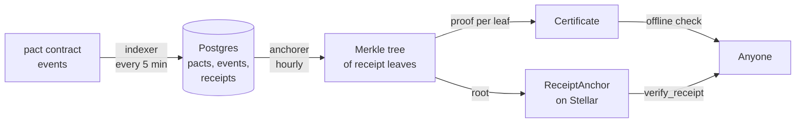

<p align="center">
  <picture>
    <source media="(prefers-color-scheme: dark)" srcset="brand/pactwright-logo-dark.svg">
    
  </picture>
</p>

<p align="center">
  <b>Where every pact becomes visible and provable.</b><br>
  Public pact timelines, verifiable receipts, and dashboards for sellers and agent owners.
</p>

<p align="center">
  <a href="https://github.com/Pactwright/Pactwright-studio/actions/workflows/ci.yml"></a>
  <a href="LICENSE"></a>
  <a href="https://scorecard.dev/viewer/?uri=github.com/Pactwright/Pactwright-studio"></a>
</p>

<p align="center">
  <a href="https://pactwright-studio-testnet.onrender.com"><strong>Open Studio</strong></a> ·
  <a href="https://pactwright.github.io/docs/"><strong>Documentation</strong></a> ·
  <a href="#-quick-start"><strong>Quick start</strong></a> ·
  <a href="#-anchoring-and-dashboards"><strong>Anchoring</strong></a>
  <!-- demo: add a Docs · Dashboard · Demo link row here when a screencast exists -->
</p>

> [!IMPORTANT]
> **Live on testnet: [pactwright-studio-testnet.onrender.com](https://pactwright-studio-testnet.onrender.com).** It indexes the
> `pact` contract every 5 minutes and anchors receipts on the deployed `ReceiptAnchor` every hour;
> every proof verifies on-chain with `verify_receipt`. Testnet only, not audited. The seller and
> agent-budget pages still show sample data. [What works today](#what-works-today) has the details.

## Contents

1. [Overview](#-overview)
2. [Architecture](#️-architecture)
3. [How a receipt becomes provable](#how-a-receipt-becomes-provable)
4. [Trust and privacy](#trust-and-privacy)
5. [Testnet pacts](#-testnet-pacts)
6. [Anchoring and dashboards](#-anchoring-and-dashboards)
7. [What works today](#what-works-today)
8. [Supported Versions & Compatibility](#️-supported-versions--compatibility)
9. [What "Supported" means here](#what-supported-means-here)
10. [Compatibility matrix](#compatibility-matrix)
11. [Quick Start](#-quick-start)
12. [1. Installation](#1-installation)
13. [2. Configuration](#2-configuration)
14. [3. Usage](#3-usage)
15. [Deploy](#deploy)
16. [Measurements](#-measurements)
17. [Community & Maintainers](#-community--maintainers)
18. [Contributing](#️-contributing)
19. [Contributors](#‍-contributors)
20. [License](#license)

## 📖 Overview

An escrow contract settles the money, but people still need to *see* what happened and to *prove* it later. Studio is the public face of a pact: it follows the contract on-chain, renders one page per purchase, and turns each final outcome into a receipt that anyone can check without trusting Studio, GitHub, or whoever happens to be hosting the page.

| Question | Without Studio | With Studio |
|---|---|---|
| "What happened to my purchase?" | Read raw contract events in an explorer | A timeline page per pact: opened, verdict, settled or released, with links to every transaction |
| "Can I prove I paid for this?" | Trust the seller's server | A certificate: a receipt plus a Merkle proof against a root anchored on Stellar |
| "Is the certificate real?" | Ask whoever issued it | Check the proof yourself, offline, or against `ReceiptAnchor.verify_receipt` on-chain |
| "How is my business doing?" | Spreadsheet the events | Merchant dashboard: revenue, refund and dispute rates, cost per route |
| "What are my agents spending?" | Track every wallet by hand | Principal view: budgets and live pacts per agent |

The interface keeps three objects that carry meaning: the Pactwright **seal**, which presses in when a certificate verifies; **stamps** for a pact's state (teal when the money moved as agreed, rose when it came back, indigo while it is in escrow); and the timeline as a **chain of blocks**, each labelled with its ledger. Amounts and events are in plain words ("1.00 USDC to the seller, 0.00 USDC back to the buyer"). It works without JavaScript for lookup, respects reduced motion, and has been audited at phone, tablet and desktop sizes, including at 200% text.

### 🏗️ Architecture

Five parts, and only one of them can move money (it cannot — the contract does):

1. **Indexer** — reads `pact` and `RefundVault` events from Stellar RPC on a schedule, keeps one cursor per source, and writes idempotently, so a re-run never double-counts. If the cursor falls behind RPC retention it backfills from an archival RPC or an HTTP history source, and raises an alert at 50% of the retention window.
2. **Receipt leaves** — when a pact reaches a final state (settled, released or refunded), its outcome is hashed into a leaf covering who paid whom, how much, and in which transaction. The leaf is byte for byte the contract's `receipt_leaf`, tested against its vectors, and every receipt keeps its leaf inputs so anyone can recompute it.
3. **Anchorer** — collects pending leaves into a sorted-pair SHA-256 Merkle tree in Accensa's `ReceiptAnchor` format, bounded by a maximum batch size and a minimum interval. Each batch is recorded as a plan before it is sent; the next run reconciles plans against the chain first, so a batch is never anchored twice or lost.
4. **Certificate** — the receipt plus the sibling hashes from leaf to root. Recompute the root offline and compare it with the anchored one; that is the whole proof, and it needs nothing from Studio.
5. **Web app** — a Next.js app over the same Postgres: public timeline, certificate viewer, merchant and principal dashboards, and an ops health route.

| Path | What |
|---|---|
| [`apps/web/app`](apps/web/app) | Next.js pages and API routes |
| [`apps/web/lib/indexer`](apps/web/lib/indexer) | Event sources, decoding, cursor, backfill |
| [`apps/web/lib/anchorer`](apps/web/lib/anchorer) | Reconcile → batch → anchor → proofs (core-team path) |
| [`apps/web/lib/verify.ts`](apps/web/lib/verify.ts) | Receipt leaves and offline proof verification |
| [`apps/web/lib/ops`](apps/web/lib/ops) | Monitoring signals |
| [`apps/web/components`](apps/web/components) | Timeline, certificate card, transaction links |
| [`apps/web/test`](apps/web/test) | Unit tests and Playwright specs |
| [`migrations`](migrations) | Schema, migration runner and seed data |
| [`templates/pollar-studio`](templates/pollar-studio) | Storefront template for Pollar Studio sellers |
| [`docs`](docs) | PRD, architecture, essentials, project structure |

### How a receipt becomes provable

Anchoring each receipt in its own transaction would be expensive, so Studio batches many receipts into one Merkle tree and anchors only its root. A single small transaction covers hundreds of receipts, and every receipt in it can still be proven on its own.



### Trust and privacy

**You do not have to trust Studio.** A certificate is a receipt plus a Merkle proof: recompute the root yourself and compare it with the anchored root, or call `verify_receipt` on the `ReceiptAnchor` contract directly. Studio only saves you the work.

**If Studio goes down, nothing stops.** The money is never in Studio — the contract holds and moves it. Pacts keep working, and already-issued certificates stay verifiable against the anchored roots.

**Pact data is public by design**, because the chain it comes from is public. The merchant and principal dashboards have no sign-in yet, so do not put private data in them before that lands.

## 📊 Anchoring and dashboards

Batch 1 anchored **9 receipts** in one transaction, signed by the `ReceiptAnchor` admin key: [`be51068e…`](https://stellar.expert/explorer/testnet/tx/be51068eea65b8f47799253ca45bd5e5d9c014d7cae0b873f19150658d8edfb0). Every proof in it verifies offline and with ReceiptAnchor's own `verify_receipt`.

Who sees what:

| Who | Page | What they see |
|---|---|---|
| **Anyone** | `/` | Pact lookup and the latest pacts |
| **Anyone** | `/pact/<id>` | The public timeline of one pact, with Stellar Expert links per network (`/pact?id=…` redirects here, so lookup works without JavaScript) |
| **Anyone** | `/verify` | Paste a certificate and check its proof offline, then check the anchored root on-chain |
| **Sellers** | `/merchant` | Revenue, refund and dispute rates, cost per route |
| **Agent owners** | `/principal` | Budgets and live pacts for each agent they run |
| **Operators** | `/api/ops/health` | Sponsor balance, indexer lag, pending certificates, verifier error rate |

Run the live check yourself (it sends real `anchor_batch` transactions):

```bash
DATABASE_URL=… ANCHORER_SECRET=S… STELLAR_NETWORK=testnet STELLAR_RPC_URL=https://soroban-testnet.stellar.org \
PACT_CONTRACT_ID=CDUXJJUNYFILEYHE3LITANJEKCDFERNAABOSG75OWATFVM776BCMFEV6 \
RECEIPT_ANCHOR_ID=CAEO5GBC3ULRC5RYBSCSOXLNXHU2HZAHNW5HY5LZM3DIPFMX357ILNJ2 INDEX_START_LEDGER=… \
pnpm --filter web live:testnet
```

### What works today

| Piece | Status | Notes |
|---|---|---|
| Postgres schema and migrations | ✅ Working | `001_core.sql`, `002_accounts.sql`, `003_receipt_anchor_v020.sql`. Each file is applied once; the runner records what it applied |
| Indexer: Stellar RPC `getEvents` | ✅ Testnet | `pact` events and RefundVault refunds, one cursor per source, one database transaction per event, idempotent |
| Receipt leaves | ✅ Working | Byte for byte as the contract's `receipt_leaf`, tested against its vectors. Each receipt keeps its leaf inputs so anyone can recompute it |
| Anchorer: `anchor_batch` | ✅ Testnet | Real transactions signed by the ReceiptAnchor admin key. Batch 1: 9 receipts, [`be51068e…`](https://stellar.expert/explorer/testnet/tx/be51068eea65b8f47799253ca45bd5e5d9c014d7cae0b873f19150658d8edfb0) |
| Crash safety | ✅ Working | Each batch is recorded as a plan before it's sent; the next run settles plans against the chain, so a batch is never anchored twice or lost |
| Certificates | ✅ Testnet | Every anchored proof verifies offline and with ReceiptAnchor's own `verify_receipt` |
| Lag alerting | ✅ Working | Alert at 50% of RPC retention |
| Backfill from a history source | ✅ Working | If the cursor falls outside RPC retention, `sync` backfills from an archival RPC (`HISTORY_RPC_URL`) or an HTTP history source; without one it stops with an error rather than skip events |
| M0 pacts | 🚧 Not yet | M0 pacts aren't opened on-chain, so Studio learns of them from the facilitator (X-*). Until then, their refunds are skipped |
| Home page, pact timeline, certificate viewer | ✅ Testnet | Live; Playwright end-to-end tests. Checked at phone, tablet and desktop sizes |
| Merchant dashboard, principal view | 🧪 Seeded data | No sign-in yet |
| Ops health probes | 🚧 Partial | Indexer lag, RPC retention and the anchoring backlog are measured; sponsor balance and verifier error rate aren't yet |
| Pollar Studio storefront template | ✅ Template | `templates/pollar-studio`, built with the public Pollar SDK only |
| Hosted deployment | ✅ Testnet | [pactwright-studio-testnet.onrender.com](https://pactwright-studio-testnet.onrender.com) on Render. The [`studio-cron`](.github/workflows/studio-cron.yml) workflow syncs every 5 minutes and anchors hourly |

## ⚙️ Supported Versions & Compatibility

Studio is a Next.js app plus an indexer, so the thing that actually constrains a deployment is the Node and pnpm pair the workspace pins, and the Stellar network the anchorer signs for. Both are read from the manifests, not from memory:

| Item | Pin | Read from |
|---|---|---|
| Node.js | `>=24` (CI uses `.nvmrc`) | root `package.json` `engines`, `ci.yml` |
| pnpm | `10.34.7` | root `package.json` `packageManager` |
| Next.js | `^16.0.0` | `apps/web/package.json` |
| React | `^19.2.0` | `apps/web/package.json` |
| `@stellar/stellar-sdk` | `^16.4.1` | `apps/web/package.json` |
| `pg` | `^8.16.0` | `apps/web/package.json` |
| TypeScript | `^5.9.0` | `apps/web/package.json` |
| Vitest / Playwright | `^4.0.0` / `^1.56.0` | `apps/web/package.json` |

### What "Supported" means here

`Supported` means the gate runs on every push and pull request to `main`: [`ci.yml`](.github/workflows/ci.yml) installs with `--frozen-lockfile`, then `pnpm typecheck` and `pnpm test`; [`e2e.yml`](.github/workflows/e2e.yml) applies the migrations, seeds data, builds the app and runs the Playwright specs; [`migrations.yml`](.github/workflows/migrations.yml) checks the schema files; [`roadmap-check.yml`](.github/workflows/roadmap-check.yml) fails a pull request that does not touch `ROADMAP.md`.

The network side is verified by hand, not continuously: the anchoring figures below were produced against Stellar testnet on 2026-10-29 with deployed contract addresses ([`DEPLOYMENTS.md`](https://github.com/Pactwright/Pactwright-contracts/blob/main/DEPLOYMENTS.md)). A row marked `Untested` has neither CI coverage nor a manual run, and `Not implemented` means the code refuses rather than guesses.

### Compatibility matrix

| Target | Status | Notes |
|---|---|---|
| **Node 24, pnpm 10.34.7** | **Supported** | The exact pair CI installs and tests with |
| **Older Node / pnpm** | **Untested** | `engines` requires Node ≥24; the lockfile is pnpm 10 |
| **Stellar testnet** | **Supported** | Live: indexing, anchoring, certificate verification |
| **Stellar pubnet** | **Not implemented** | Startup refuses the plaintext anchorer key on pubnet; `ANCHORER_SECRET_REF` (KMS) is not supported yet |

## 🚀 Quick Start

### 1. Installation

Requires Node.js 24, pnpm 10 and a PostgreSQL database.

```bash
git clone https://github.com/Pactwright/Pactwright-studio.git && cd Pactwright-studio
pnpm install
cp .env.example .env          # set DATABASE_URL, e.g. postgres://localhost:5432/pactwright
pnpm db:migrate               # creates the schema
pnpm db:seed                  # loads fixture pacts, receipts and accounts
```

### 2. Configuration

| Variable | Purpose |
|---|---|
| `DATABASE_URL` | Managed Postgres connection string |
| `STELLAR_NETWORK`, `STELLAR_NETWORK_PASSPHRASE`, `STELLAR_RPC_URL` | Network. Startup fails if these are incomplete or inconsistent |
| `HISTORY_RPC_URL` / `HISTORY_SOURCE_URL` | Backfill when the cursor falls outside RPC retention: an archival Stellar RPC, or an HTTP service returning base64-XDR events and `scannedThroughLedger` |
| `PACT_CONTRACT_ID`, `RECEIPT_ANCHOR_ID`, `FACILITATOR_URL` | What to index and where to anchor ([addresses](https://github.com/Pactwright/Pactwright-contracts/blob/main/DEPLOYMENTS.md)) |
| `INDEX_START_LEDGER`, `REFUND_VAULT_IDS` | First ledger to index; RefundVaults whose refunds are indexed |
| `ANCHORER_SECRET` | `ReceiptAnchor` admin key, testnet only (refused on pubnet) |
| `ANCHORER_SECRET_REF` | KMS reference to the anchorer key for pubnet (not supported yet) |
| `CRON_SECRET` | Protects `/api/sync` and `/api/anchor` |

### 3. Usage

```bash
pnpm dev                      # http://localhost:3000
```

The routes the app serves:

| Route | Kind | Purpose |
|---|---|---|
| `/` | Page | Pact lookup and the latest pacts |
| `/pact/[id]` | Page | Public pact timeline (`/pact?id=…` redirects here, so lookup works without JavaScript) |
| `/verify` | Page | Certificate viewer: offline proof plus on-chain status |
| `/merchant` | Page | Seller dashboard |
| `/principal` | Page | Agent owner view |
| `GET /api/pacts/:id` | API | A pact and its events |
| `GET /api/certificates/:id` | API | A certificate: `pending` until anchored, then `anchored` with its proof |
| `GET /api/sync` | Cron | One indexer cycle (requires `CRON_SECRET`) |
| `GET /api/anchor` | Cron | One anchoring cycle (requires `CRON_SECRET`) |
| `GET /api/ops/health` | Ops | Health and monitoring signals |

The data behind those pages:

| Table | Holds |
|---|---|
| `pacts` | One row per pact: parties, cap, state, amounts, deadlines |
| `pact_events` | Every on-chain event, keyed so a re-index is idempotent |
| `verdicts` | Verifier envelopes and attestations per pact and milestone |
| `receipts` | One leaf per final outcome, with its batch and proof once anchored |
| `receipt_batches` | Each anchored Merkle root and its transaction |
| `sync_state` | The indexer's cursor per source |
| `sellers`, `routes`, `agents`, `budgets` | Accounts for the dashboards (v1) |

Tests:

```bash
pnpm typecheck
pnpm test                     # 62 unit tests
pnpm --filter web e2e         # 3 Playwright end-to-end tests
```

### Deploy

Testnet is live at [pactwright-studio-testnet.onrender.com](https://pactwright-studio-testnet.onrender.com), hosted on Render from [`render.yaml`](render.yaml): the web app and a managed Postgres. Migrations run before every deploy. Render's free tier has no cron jobs, so the [`studio-cron`](.github/workflows/studio-cron.yml) GitHub Actions workflow calls `/api/sync` every 5 minutes and `/api/anchor` every hour. It needs the repository secrets `STUDIO_URL` and `CRON_SECRET` (the same value as on Render), and fails loudly without them.

1. Render Dashboard → **New → Blueprint** → this repo.
2. Fill in the `sync: false` values when asked. They stay in Render's secret store: `ANCHORER_SECRET` (the `ReceiptAnchor` admin key, testnet only), `INDEX_START_LEDGER`, `REFUND_VAULT_IDS` and `FACILITATOR_URL`, and `CRON_SECRET` (also set as a repository secret for the `studio-cron` workflow).
3. Check `/api/ops/health`: indexer lag must stay under 50% of RPC retention.

[`vercel.json`](vercel.json) keeps the same two schedules for a Vercel deployment.

```bash
DATABASE_URL="<hosted-postgres-url>" pnpm db:migrate
```

## 📊 Measurements

Every figure in this README is recorded somewhere you can open, not remembered:

- **Anchoring**: batch 1's transaction is linked above; `verify_receipt` on the deployed `ReceiptAnchor` confirms each leaf in it.
- **Tests**: 62 unit tests across 12 suites, measured 2026-10-30 with `pnpm test`; the 3 Playwright end-to-end specs run in [`e2e.yml`](.github/workflows/e2e.yml), not locally.
- **Testnet purchase**: the pact the hosted verifier judged with its real model is [`40725564…5c55`](https://pactwright-studio-testnet.onrender.com/pact/4072556402d709463f7cb888a4a9e03b061d906f0b7ca5c49ebb2eec4e7d5c55).
- **Network figures** for the pacts below come from the [Pactwright-Kit testnet e2e](https://github.com/Pactwright/Pactwright-Kit/tree/main/e2e/testnet) report, not from Studio.

## 📊 Testnet pacts

Every MVP scenario ran as real testnet transactions on 2026-10-29 ([Pactwright-Kit testnet e2e](https://github.com/Pactwright/Pactwright-Kit/tree/main/e2e/testnet)). The escrow (M2) pacts are on the `pact` contract, so Studio indexes them; exact-refund (M0) purchases are direct payments, not on-chain pacts, so they don't appear yet.

| Scenario | Outcome | Transactions |
|---|---|---|
| M0 ALLOW | ALLOW, seller keeps 1 | [`e1105f24…`](https://stellar.expert/explorer/testnet/tx/e1105f24d40640eb66a73968c06ae4eedc9f860097a086b0f4450c25995c6600) |
| M0 DENY | DENY, 1 refunded | [`ae9975c0…`](https://stellar.expert/explorer/testnet/tx/ae9975c028fe6d6bb2159cf4b532cebf42dc6ff8de095adedbac29b52542b8a3) · [`2b78feb8…`](https://stellar.expert/explorer/testnet/tx/2b78feb8459b4731aa50bae1a290e3fd84a9a2b4956f5c6d2b7ae4f615bfae59) |
| M0 non-delivery | DENY, 0.5 refunded | [`df8af0bd…`](https://stellar.expert/explorer/testnet/tx/df8af0bd9c8f4be9477589d9991ab063134b0e9f92094a90218f5edc9a629005) · [`01357475…`](https://stellar.expert/explorer/testnet/tx/013574756ece7ae81643893f00fb14a2b220d54d096d936ea083a45129189b00) |
| M2 ALLOW | ALLOW 0.75 of 1, settled | [`0b08b71e…`](https://stellar.expert/explorer/testnet/tx/0b08b71e164252de154d6500b3b8c23c0d68f6a8a1710b87b86e79bbe1166f6c) · [`84a6549a…`](https://stellar.expert/explorer/testnet/tx/84a6549aaa6b61b0e8040d1b43f2819914dc0e40f52d85be871f455d0d5a3e71) · [`9fda6bea…`](https://stellar.expert/explorer/testnet/tx/9fda6beadb02f863f74e220820642a4509f269c31e3462fccf6318e1e2fa11c5) |
| M2 DENY | DENY, full refund | [`b953ee00…`](https://stellar.expert/explorer/testnet/tx/b953ee00524d5b0a9b53308ab1e370a2008fb82b7f5a949ac1934d2aa12d17a7) · [`324f630d…`](https://stellar.expert/explorer/testnet/tx/324f630d39eb88fa76a60b92617e5867421e9819c290a8f3d71ec4bd8bec9138) · [`272703bf…`](https://stellar.expert/explorer/testnet/tx/272703bfbe0a74becf50a80b5d16600396a17440a82c9b3af5c481d4748c22cf) |
| M2 silence | no verdict, refunded by silence policy | [`76df8318…`](https://stellar.expert/explorer/testnet/tx/76df83188eb7cf22c0b6c639fc0a090615ca3040ecfb6a3e43d6347cece27d59) · [`e62aff4d…`](https://stellar.expert/explorer/testnet/tx/e62aff4d291eff2b76ba282aae987d82c6ca91e1681e7944d96abb1f3739f833) |
| Dispute refund | dispute-1: 2 of 4 pages, 0.5 refunded | [`a191a000…`](https://stellar.expert/explorer/testnet/tx/a191a000f7920f2fff9839bbccceeeca35c82fce29a5e46510fd3db1bcdf2ff0) |

What is next, from [`ROADMAP.md`](ROADMAP.md): real data for the seller and agent-budget pages (registration and sign-in), indexing exact-refund purchases, and holding the anchorer key in a KMS before any mainnet deployment.

### Built on

| Project | What Studio uses | How |
|---|---|---|
| [Accensa](https://github.com/accensa) | `ReceiptAnchor` (Merkle roots on-chain), `RefundVault` events, indexer patterns | Same Merkle format; anchors to `ReceiptAnchor` v0.2.0; indexes `RefundVault` refunds |
| [Tollcraft](https://github.com/Tollcraft) | Contract cost reports | Cost per route in the merchant dashboard |
| [Pollar](https://docs.pollar.xyz) | Seller storefronts | `templates/pollar-studio`, built with the public SDK only |
| [Witness](https://github.com/fabian416/witness) | Verdict envelopes | Stored with each pact (`verdicts` table) |

## 🤝 Community & Maintainers

<!-- socials: add Discord / Telegram / X links here when they exist. -->

- Documentation hub: [pactwright.github.io/docs](https://pactwright.github.io/docs/)
- The other repositories: [Contracts](https://github.com/Pactwright/Pactwright-contracts) · [Kit](https://github.com/Pactwright/Pactwright-Kit)
- Security reports: see [`SECURITY.md`](SECURITY.md) — privately, never a public issue.

| Maintainer | Role |
|---|---|
| Pactwright core team | Indexer, anchorer, web app and schema |

## 🛠️ Contributing

Read [CONTRIBUTING.md](CONTRIBUTING.md) and [AGENTS.md](AGENTS.md). Every pull request updates [ROADMAP.md](ROADMAP.md): task status, progress counts and one Update log line — a pull request that does not touch it fails `roadmap-check`. `main` is protected, so pull requests need a review and green checks. The anchorer and the migrations are core-team paths (see `CODEOWNERS`).

### 🧑‍💻 Contributors


## License

Pactwright-studio is released under the **[MIT License](LICENSE)**.

```text
Copyright (c) 2026 Pactwright contributors
```

### What the MIT license means for you

| You may | You must | You get no |
|---|---|---|
| Use the code in open or closed-source projects, commercially or not | Keep the copyright notice and the license text in every copy or substantial portion | Warranty of any kind |
| Copy, modify, merge and publish it | | Liability from the authors for any loss |
| Distribute, sublicense and sell copies | | |
| Run your own Studio for your own pacts | | |

Running your own Studio doesn't make its certificates any less verifiable. Proofs check against the on-chain root, not against whoever hosts the page.

### Third-party code and licenses

| Component | How it is used | License |
|---|---|---|
| [Next.js](https://www.npmjs.com/package/next) | The web app | MIT |
| [React](https://www.npmjs.com/package/react) | UI | MIT |
| [node-postgres (`pg`)](https://www.npmjs.com/package/pg) | Database access | MIT |
| Vitest, Playwright, TypeScript | Development and tests only, not shipped | MIT / Apache-2.0 |
| Accensa `ReceiptAnchor` format | Merkle tree format; Studio anchors to the deployed contract but includes none of its code | MIT |

Pollar Studio has no license file, so none of its code is used. The storefront template uses only the public Pollar SDK. Every project Pactwright builds on is credited in [NOTICE](NOTICE).

### The other Pactwright repositories

| Repository | License | Why |
|---|---|---|
| [Pactwright-contracts](https://github.com/Pactwright/Pactwright-contracts) | MIT | Short, permissive terms |
| [Pactwright-Kit](https://github.com/Pactwright/Pactwright-Kit) | Apache-2.0 | It vendors Witness core, which is Apache-2.0, and adds an explicit patent grant |
| Pactwright-studio (this repo) | MIT | Same terms as the contracts |

### Contributing under this license

By opening a pull request, you agree that your contribution is licensed under the same MIT license as the rest of the repository. There is no separate contributor license agreement.
