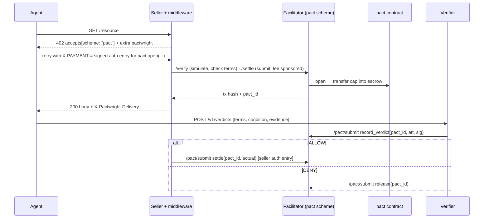

# Pactwright — Architecture

| | |
|---|---|
| Status | Draft v0.2 — 2026-10-28 (all §16 review proposals of v0.1 accepted) |
| Scope | All three repos: `pactwright-contracts`, `pactwright-kit`, `pactwright-studio`, plus a new `pact` scheme in `accensa/x402-facilitator-stellar` |
| Read first | [`PRD.md`](PRD.md) for what and why · [`ARCHITECTURE_ESSENTIALS.md`](ARCHITECTURE_ESSENTIALS.md) for the short version · [`project_structure.md`](project_structure.md) for files · [`ROADMAP.md`](ROADMAP.md) for remaining work |
| Process | **Every contribution updates [`ROADMAP.md`](ROADMAP.md).** Design changes need an ADR first and must update this file, the essentials and the roadmap in the same PR ([`AGENTS.md`](AGENTS.md)). |

---

## 1. Principles

1. **Compose, don't rebuild.** Payment rail, refunds and receipts come from Accensa; cost gates from Tollcraft; the verdict format from Witness. Pollar, Vespi, BookerBob and the Ficha metering idea are add-ons behind adapters.
2. **The contract enforces the lifecycle; services only propose.** No service and no admin can move pact funds.
3. **One stage, one transaction, one event.**
4. **Hashes on-chain, data off-chain.**
5. **Say what each mode really guarantees.** M0 refunds are seller-cooperative; only M2 guarantees the buyer's money.
6. **Cost is a test, not a hope.** Every contract entrypoint has a Tollcraft budget test.
7. **The receipt is the permanent record.** Pact storage may archive after a terminal state; anchored receipts do not.
8. **Smallest thing that works.** One verifier key, two modes, no separate relayer.

## 2. Settlement modes (ADR-001)

| Mode | Money | Buyer guarantee | Seller guarantee | Where it runs |
|---|---|---|---|---|
| **M0 — exact-refund** | Standard x402 `exact` payment to the seller; DENY → seller's `RefundVault.refund` | **Refund-promised (seller-cooperative)**, bounded by the seller's vault float | Paid up front | Off-chain pact; any x402 facilitator |
| **M2 — escrow** | `pact` contract holds the cap; ALLOW → seller is paid `actual`, rest returned; DENY / deadlines → buyer gets it back | **Guaranteed** by the contract | **Guaranteed** once ALLOW (or signed usage for metered pacts) is recorded | `pact` contract via the facilitator's `pact` scheme |

**Metered pacts** are M2 pacts with `MeterTerms`. They skip the verifier: the buyer's
signed cumulative usage voucher is the proof (ADR-010).

**Deferred:** M1 (allowance via Accensa `upto-authorization`). Two concurrent M1 pacts from
one buyer overwrite each other's SEP-41 allowance, settlement needs the buyer to co-sign,
and funds are not locked. M1 returns only when Accensa's ADR-002 resolves the `upto`
construction (ADR-002 here, superseded).

## 3. System context

```mermaid
flowchart LR
  subgraph Agent side
    A[AI agent]
    MCP[@pactwright/mcp]
    AG[@pactwright/agent]
  end
  subgraph Seller side
    API[Seller x402 endpoint]
    MW[@pactwright/seller]
  end
  subgraph Pactwright services
    VER[Verifier<br/>Witness verdict-v1]
    STU[Studio<br/>indexer · anchorer · UI]
    DB[(Postgres)]
  end
  FAC[Accensa x402 facilitator<br/>exact + pact scheme + /pact/submit<br/>Bazaar discovery]
  subgraph Soroban
    PACT[pact contract<br/>escrow]
    RV[RefundVault<br/>per seller]
    RA[ReceiptAnchor<br/>Pactwright instance]
    USDC[USDC SAC]
  end
  A --> MCP --> AG
  AG -->|discover| FAC
  AG -->|request / 402 / retry| API
  API --- MW
  MW -->|/verify /settle| FAC
  FAC -->|M0 exact| USDC
  FAC -->|M2 open, verdict, settle, release| PACT --> USDC
  AG -->|evidence + delivery receipt| VER
  VER -->|M2 attestation via /pact/submit| FAC
  VER -->|M0 DENY webhook| MW
  MW -->|M0 refund| RV --> USDC
  STU -->|getEvents + backfill| PACT
  STU -->|anchor_batch| RA
  STU --> DB
```

Add-ons (P1+): `gate-vespi` and `wallet-pollar` in the agent; `reputation-bookerbob` in discovery; proof-of-purchase hook in the seller middleware (P2).

## 4. On-chain design

### 4.1 Contracts and instances

| Contract | Source | Owner | Purpose |
|---|---|---|---|
| `pact` | `pactwright-contracts` | admin = Pactwright (config + verifier key only; **no fund access**) | M2 escrow, verdicts, metering, deadlines |
| `ReceiptAnchor` | Accensa, pinned WASM | admin = Pactwright anchorer key | Batched receipt roots for every terminal transition (both modes) |
| `RefundVault` | Accensa, pinned WASM | one per seller; merchant = seller | M0 refunds; post-settle disputes in either mode |
| USDC | Stellar Asset Contract | — | The only accepted token (`config.token`) |

### 4.2 Types (`contracts/pact/src/types.rs`)

```rust
#[contracttype] #[derive(Clone, Copy, PartialEq, Eq)]
pub enum PactState { Funded = 1, Allowed = 2, Denied = 3, Settled = 4, Released = 5 }

#[contracttype] #[derive(Clone, Copy, PartialEq, Eq)]
pub enum Verdict { Allow = 1, Deny = 2 }

/// What happens if no verdict arrives by `verdict_deadline` (agreed at open).
#[contracttype] #[derive(Clone, Copy, PartialEq, Eq)]
pub enum Silence { Refund = 1, Pay = 2 }

#[contracttype] #[derive(Clone)]
pub struct MeterTerms {
    pub unit_price: i128,          // stroops per unit
    pub meter_key: BytesN<32>,     // per-pact ed25519 key held by the buyer's SDK
}

/// `Option<MeterTerms>` can't be converted inside a `#[contracttype]` struct, so a contract enum is used.
#[contracttype] #[derive(Clone)]
pub enum Metering { None, Units(MeterTerms) }

#[contracttype] #[derive(Clone)]
pub struct Pact {
    pub buyer: Address,
    pub seller: Address,
    pub cap: i128,
    pub condition_hash: BytesN<32>,
    pub verifier: BytesN<32>,      // snapshot of config.verifier at open
    pub meter: Metering,
    pub silence: Silence,
    pub opened_ledger: u32,
    pub verdict_deadline: u32,
    pub settle_deadline: u32,
    pub state: PactState,
    pub allowed_amount: i128,      // from ALLOW attestation (or cap under Silence::Pay)
    pub envelope_hash: Option<BytesN<32>>,
    pub paid_to_seller: i128,
    pub returned_to_buyer: i128,
}

/// Arguments of `open`, bundled in one struct.
#[contracttype] #[derive(Clone)]
pub struct OpenParams {
    pub buyer: Address,
    pub seller: Address,
    pub cap: i128,
    pub nonce: u64,
    pub condition_hash: BytesN<32>,
    pub meter: Metering,
    pub silence: Silence,
    pub verdict_deadline: u32,
    pub settle_deadline: u32,
}

#[contracttype] #[derive(Clone)]
pub struct VerdictAttestation {
    pub pact_id: BytesN<32>,
    pub condition_hash: BytesN<32>,
    pub envelope_hash: BytesN<32>, // sha256 of the Witness verdict-v1 envelope
    pub verdict: Verdict,
    pub amount: i128,              // owed to the seller, ≤ cap (partial delivery)
    pub issued_ledger: u32,
}

#[contracttype] #[derive(Clone)]
pub struct UsageVoucher {
    pub pact_id: BytesN<32>,
    pub units: u32,                // cumulative
}

#[contracttype] #[derive(Clone)]
pub struct Config {
    pub admin: Address,
    pub token: Address,
    pub verifier: BytesN<32>,
    pub max_pact_ledgers: u32,     // upper bound on settle_deadline − now
}
```

### 4.3 Identifiers and hashing (source of truth: `pactwright-contracts/test-vectors/`, ADR-015)

| Value | Definition |
|---|---|
| `nonce` | `u64_be(sha256(idempotency_key)[0..8])`; the agent derives `idempotency_key` from its request, so retries reuse the same pact |
| `pact_id` | `sha256(xdr(buyer) ‖ xdr(seller) ‖ nonce ‖ condition_hash)`; same formula for M0 (off-chain) and M2 (computed in `open`) |
| `condition_hash` | Witness `conditionHash()`: sha256 of canonical JSON |
| `envelope_hash` | sha256 of the canonical verdict-v1 envelope (`verdict-v1 sha256=<hex> uri=<uri>`) |
| Verdict message | `sha256("pactwright-verdict-v1:" ‖ xdr(VerdictAttestation))`, ed25519 |
| Usage message | `sha256("pactwright-usage-v1:" ‖ xdr(UsageVoucher))`, ed25519 with `meter_key` |
| Delivery message | `sha256("pactwright-delivery-v1:" ‖ pact_id ‖ sha256(response_body))`, ed25519 with the seller's declared `deliveryKey` |
| Receipt leaf | `sha256("pactwright-receipt-v1" ‖ pact_id ‖ transition_u32 ‖ to_seller_i128 ‖ to_buyer_i128 ‖ envelope_hash_or_zero ‖ ledger_u32)`; **one leaf per terminal transition** (ADR-013) |
| Transitions | `1 Paid` (M0 exact) · `2 Settled` · `3 Released` · `4 Refunded` (RefundVault) |
| Merkle | Sorted-pair SHA-256, identical to Accensa `ReceiptAnchor` / `verifyReceipt()` |

All domain prefixes differ from each other and from Witness's `conditional-release-verdict-v1:`.

### 4.4 Entrypoints

| Function | Auth | Preconditions | Effect |
|---|---|---|---|
| `__constructor(admin, token, verifier, max_pact_ledgers)` | — | — | Stores `Config` |
| `set_verifier(key)` | admin | — | Rotates the key **for new pacts only** (ADR-014) |
| `open(params: OpenParams) → pact_id` (`OpenParams` = buyer, seller, cap, nonce, condition_hash, meter, silence, verdict_deadline, settle_deadline) | buyer | `cap > 0`; `buyer ≠ seller`; `now < verdict_deadline ≤ settle_deadline ≤ now + max_pact_ledgers`; `pact_id` unused | `token.transfer(buyer → pact, cap)`; snapshot `verifier`; TTL extended past `settle_deadline + GRACE` → `Funded` |
| `record_verdict(pact_id, att, sig)` | none (signature is the authority) | `Funded`; not metered; `now ≤ verdict_deadline`; `att.pact_id`/`condition_hash` match; `att.amount ≤ cap`; `ed25519_verify(pact.verifier, msg, sig)` | ALLOW → `Allowed`, `allowed_amount = att.amount`; DENY → `Denied` |
| `settle(pact_id, actual)` | seller | `0 < actual ≤ allowed_amount`, `now ≤ settle_deadline`, and either `Allowed`, or `Funded ∧ not metered ∧ silence = Pay ∧ now > verdict_deadline` (then `allowed_amount = cap`) | `actual` → seller, `cap − actual` → buyer → `Settled` |
| `close_meter(pact_id, units, sig)` | seller | `Funded`; metered; `now ≤ settle_deadline`; `ed25519_verify(meter_key, usage msg, sig)`; `units × unit_price ≤ cap` | Pays `units × unit_price`, returns the rest → `Settled` |
| `release(pact_id)` | none | `Denied`; **or** `Funded ∧ not metered ∧ silence = Refund ∧ now > verdict_deadline`; **or** `(Funded ∨ Allowed) ∧ now > settle_deadline` | Full escrow → buyer → `Released` |
| `get_pact`, `get_config` | — | — | Reads |
| `extend_pact_ttl(pact_id)` | none | non-terminal | TTL bump |

The release rules mean: a DENY refunds at once; a silent verifier triggers the agreed
silence policy; a seller who never settles (or whose USDC trustline is frozen) lets the
buyer recover funds after `settle_deadline`.

### 4.5 Invariants (one named test each)
1. A pact reaches exactly one terminal state (`Settled` or `Released`).
2. `paid_to_seller + returned_to_buyer == cap` at terminal state.
3. The contract's token balance equals the sum of `cap` over non-terminal pacts.
4. No entrypoint lets `admin` move funds or change an open pact.
5. An attestation is bound to one `pact_id` and one `condition_hash`; a second `record_verdict` always fails (state is no longer `Funded`).
6. `set_verifier` never affects an already-open pact.
7. `settle`/`close_meter` never succeed after `settle_deadline`; `release` never succeeds for an `Allowed` pact before it.
8. Metered pacts never accept a verdict; verdict pacts never accept `close_meter`.

### 4.6 Events — topics `("pact", <name>)`, `pact_id` first in data
`opened` (buyer, seller, cap, condition_hash, metered, silence, verdict_deadline, settle_deadline) · `verdict` (verdict, amount, envelope_hash) · `settled` (to_seller, to_buyer) · `meter_closed` (units, to_seller, to_buyer) · `released` (reason: `denied` | `silence` | `deadline`, to_buyer) · `verifier_set` (key).

### 4.7 Errors
`NotInitialized, AlreadyExists, PactNotFound, InvalidState, InvalidAmount, SelfDealing,
BadDeadlines, VerdictWindowClosed, SettleWindowClosed, NotReleasable, AttestationMismatch,
BadSignature, NotMetered, IsMetered, Unauthorized`. Panics only via `panic_with_error!`.

### 4.8 Storage and TTL

| Key | Storage | TTL |
|---|---|---|
| `Config` | instance | Extended on every call |
| `Pact(BytesN<32>)` | persistent | Extended at `open` to outlive `settle_deadline + GRACE`, so an open pact cannot archive with funds in it; may archive after a terminal state (ADR-009) |

No unbounded data in instance storage.

### 4.9 M0 on-chain footprint
M0 has no `pact` contract call. Money moves through the facilitator's `exact` scheme;
refunds through `RefundVault.refund(payment_ref = pact_id, recipient = buyer, amount,
paid_at_ledger, payment_amount, vdf_proof = None, nonce)`, signed by the seller. The
`RefundVault` rejects a second refund for the same `payment_ref` (`AlreadyRefunded`).

## 5. Flows

### 5.1 M0 — exact-refund
```mermaid
sequenceDiagram
  participant Ag as Agent
  participant S as Seller + middleware
  participant F as Facilitator
  participant V as Verifier
  participant RV as RefundVault
  Ag->>S: GET /resource (X-Pactwright-Idempotency)
  S-->>Ag: 402 accepts[exact] + extra.pactwright {condition, deliveryKey, verify}
  Ag->>Ag: freeze condition → condition_hash; nonce; pact_id
  Ag->>S: retry with X-PAYMENT + X-Pactwright-Pact headers
  S->>F: /verify, /settle (exact)
  S-->>Ag: 200 body + X-Pactwright-Delivery (signed body hash)
  opt route.verify.minAmount ≤ price
    Ag->>V: POST /v1/verdicts {terms, condition, evidence: body + delivery receipt}
    V-->>Ag: envelope (ALLOW / DENY, amount)
    alt DENY or partial
      V->>S: webhook verdict
      S->>RV: refund(pact_id, buyer, price − amount, …)
    end
  end
```
- **Buyer submits the evidence** (ADR-012). The delivery receipt proves exactly what the seller sent, so neither side can fake it.
- **Non-delivery:** if the agent gets no `200` within `deliveryTimeout`, it files a non-delivery claim; the verifier asks the seller (webhook) for a delivery receipt; none within the window → DENY.
- **Cheap calls:** below `verify.minAmount` the pact is receipted but not verified (cost guard, B12).

### 5.2 M2 — escrow with verdict

In x402 terms, **"settle" for the `pact` scheme means "fund the escrow"**: the seller
delivers after funding is confirmed, which keeps the standard one-retry flow
(latency: one ledger, about 5 s).

### 5.3 M2 — metered (signed usage)
1. The agent's SDK creates a per-pact ed25519 `meter_key` and opens a pact with `MeterTerms{unit_price, meter_key}`.
2. As units are consumed, the SDK's background loop signs `UsageVoucher{pact_id, units}` (cumulative) and sends it to the seller. It never signs `units × unit_price > cap`.
3. The seller keeps the latest voucher and calls `close_meter(pact_id, units, sig)`; the contract checks one signature (O(1)).
4. If the buyer stops signing, the seller loses at most one unit; if the seller never closes, the buyer recovers everything after `settle_deadline`.

Credit: Ficha proved per-unit refunds of unused time on Stellar; this is the payment-channel form of the same idea.

### 5.4 Deadlines and silence policy (ADR-011)
- `verdict_deadline`: last ledger for `record_verdict`. Covers delivery + verification time.
- `settle_deadline`: last ledger for `settle` / `close_meter`. Covers the seller's settlement window.
- Verifier silent past `verdict_deadline` → `Silence::Refund` (default) lets anyone `release`; `Silence::Pay` lets the seller `settle` up to `cap`. The buyer sees the policy in the 402 before paying.

### 5.5 Disputes (post-terminal, both modes)
- `pactwright_dispute` asks the verifier to re-verify (milestone `dispute-<n>`), with a bounded window (`refundWindowLedgers`).
- A reversed verdict produces a refund through the seller's `RefundVault` (seller-cooperative in both modes; on-chain verdicts are final).
- Every refund is a new `Refunded` receipt leaf.

### 5.6 Close the loop (P2)
Seller middleware adds buyer commitments to the seller's BookerBob group **in delayed,
shuffled batches per epoch** (not right after each settlement), so the commitment can't be
linked to a buyer address by timing. Reputation weights unique buyers, account age and
amount, and ignores buyer = seller and accounts funded by the seller.

## 6. Off-chain components

### 6.1 `@pactwright/agent`
```ts
const pw = createPactwright({ network, wallet, facilitatorUrl, verifierUrl, adapters });
const sellers = await pw.find({ query, maxPrice });
const pact    = await pw.buy(seller, { condition, idempotencyKey });   // 402 → pay/open → body
const result  = await pw.await(pact, { until: "terminal" });          // verdict → settle/release
const cert    = await pw.certificate(pact.id);                        // pending | anchored
```
Metering runs as a background loop in the SDK, not through MCP tool calls.

### 6.2 Agent wallet and budget (ADR-006)
- `pactwright agent create`: creates the agent account with **sponsored reserves** (CAP-33) and a USDC trustline, so nobody has to buy XLM.
- The principal funds the agent with the approved budget. **Balance = ceiling.** Budgets are topped up in small amounts, so "revoke" is "stop topping up"; true revoke needs smart accounts (P2).
- Add-ons: `gate-vespi` approves the budget once (no per-pact approvals); `wallet-pollar` funds it from a seedless wallet.

### 6.3 `@pactwright/seller`
```ts
app.get("/translate", pact({
  mode: "exact-refund",                      // or "escrow"
  price: "0.25", asset: "USDC",
  condition: (req) => ({ kind: "document.translation", lang: req.query.to, minPages: 1 }),
  verify: { minAmount: "0.10" },             // below this: receipt only, no verification
  silence: "refund",                         // escrow only
  deadlines: { verdictLedgers: 120, settleLedgers: 720 },
  refundWindowLedgers: 17280,
  meter: undefined,                          // or { unit: "minute", unitPrice: "0.01" } (escrow)
}), handler);
```
Responsibilities: 402 with `extra.pactwright`; signed `X-Pactwright-Delivery` on every
paid response; refuse service once a pact is terminal; `createSettleHook()` for route
attribution; M0 refund hook on DENY webhooks; M2 auto-`settle` on ALLOW; checks its own
USDC trustline at startup. Keys come from KMS (B13).

### 6.4 Facilitator `pact` scheme (in `accensa/x402-facilitator-stellar`, ADR-004)
- `/verify`: simulate `pact.open`; require the invocation to be exactly `pact.open` on the configured contract with `seller == payTo`, `cap == amount`, `condition_hash == hash(condition)`, deadlines within route bounds, the only sub-invocation `token.transfer(buyer → pact, cap)`, the facilitator not a party, `pact_id` unused, and the seller's USDC trustline present.
- `/settle`: submit with fee sponsorship; return tx hash + `pact_id`.
- `POST /pact/submit`: sponsored submission of `record_verdict`, `settle`, `close_meter`, `release`, `extend_pact_ttl` on the configured `pact` contract only; reuses the facilitator's API keys, rate limits and daily fee ceiling.
- This replaces the separate relayer from v0.1.

### 6.5 Verifier service
- `POST /v1/verdicts`: verify the delivery receipt → hash-check evidence → model reads into a strict zod schema (provider and model pinned in config, explicit reasoning effort where the provider supports it, structured output; no sampling parameters such as `temperature`) → **deterministic rules decide** (`rules/<condition kind>.ts`) → Witness verdict-v1 envelope (model ID, effort, hash of raw model output) → for M2, sign one `VerdictAttestation` and submit it via `/pact/submit`.
- **A model refusal yields no verdict:** the pact falls back to its silence policy (escrow) or no refund decision (M0) instead of a guess.
- **At most one attestation per `pact_id`** (unique key in its store). Disputes create new envelopes, never new attestations.
- `GET /v1/envelopes/:sha256`, `GET /health` (public key).
- Evidence privacy: retention limit, redaction hook, configurable model region; terms tell buyers what is sent to the model.

### 6.6 Indexer and anchorer (studio)
- **Indexer:** Stellar RPC `getEvents` for `pact`, facilitator settlements to protected routes, and seller `RefundVault` refunds; ledger cursor; **backfill** from a history source when the cursor falls outside RPC retention; alert at 50% of retention.
- **Anchorer:** **reconciles from the chain first**, then builds a sorted-pair Merkle tree of new leaves (≤ `get_max_batch_size()`, respecting `min_anchor_interval`), calls `ReceiptAnchor.anchor_batch`, stores per-leaf proofs. Certificates are `pending` until anchored.

### 6.7 MCP server
`pactwright_find_sellers` · `pactwright_buy` · `pactwright_get_pact` · `pactwright_dispute` · `pactwright_get_certificate`.

## 7. Data models

### 7.1 On-chain — §4.2, §4.8.

### 7.2 TypeScript (`@pactwright/core`, zod)
```ts
export const ModeSchema = z.enum(["exact-refund", "escrow"]);
export const PactStateSchema = z.enum(["funded", "paid", "allowed", "denied", "settled", "released", "refunded"]);
export const TransitionSchema = z.enum(["paid", "settled", "released", "refunded"]);

export const PactwrightExtraSchema = z.object({          // 402 accepts[i].extra.pactwright
  version: z.literal(2),
  mode: ModeSchema,
  condition: z.record(z.string(), z.unknown()),
  deliveryKey: Hex64,                                    // seller's ed25519 delivery key
  verifier: Hex64, verifierUrl: z.string().url(),
  verify: z.object({ minAmount: z.string() }).optional(),
  pactContract: StellarAddress.optional(),               // escrow
  silence: z.enum(["refund", "pay"]).optional(),         // escrow
  deadlines: z.object({ verdictLedgers: z.number().int(), settleLedgers: z.number().int() }).optional(),
  refundVault: StellarAddress.optional(),
  refundWindowLedgers: z.number().int(),
  meter: z.object({ unit: z.string(), unitPrice: z.string() }).optional(),
});

export const CertificateSchema = z.object({
  pactId: Hex64, transition: TransitionSchema, toSeller: z.string(), toBuyer: z.string(),
  envelopeHash: Hex64.optional(), leaf: Hex64,
  status: z.enum(["pending", "anchored"]),
  proof: z.array(Hex64).optional(), shardId: z.number().int().optional(),
  batchId: z.number().int().optional(), root: Hex64.optional(),
  receiptAnchor: StellarAddress, txs: z.array(z.object({ stage: z.string(), hash: z.string() })),
});
```
Verdict envelopes use Witness's `VerificationEnvelopeSchema` unchanged (`agreementId = pactId`, `milestoneId = "delivery" | "dispute-<n>"`).

### 7.3 Postgres — MVP migration `001_core.sql` (6 tables)
```sql
create table pacts (
  pact_id         char(64) primary key,
  mode            text not null check (mode in ('exact-refund','escrow')),
  buyer           text not null,
  seller          text not null,
  resource_url    text not null,
  cap             numeric(30,7) not null,
  condition_hash  char(64) not null,
  condition       jsonb not null,
  metered         boolean not null default false,
  silence         text check (silence in ('refund','pay')),
  state           text not null,
  verdict_deadline integer, settle_deadline integer,
  to_seller       numeric(30,7) not null default 0,
  to_buyer        numeric(30,7) not null default 0,
  created_at      timestamptz not null default now(),
  updated_at      timestamptz not null default now()
);
create index pacts_seller_state on pacts (seller, state);
create index pacts_buyer on pacts (buyer, created_at desc);

create table pact_events (
  id              bigserial primary key,
  pact_id         char(64) not null references pacts(pact_id),
  stage           text not null,      -- opened, paid, verdict, settled, meter_closed, released, refunded
  tx_hash         text,
  ledger          integer,
  data            jsonb not null,
  unique (tx_hash, stage, pact_id)
);

create table verdicts (
  envelope_hash   char(64) primary key,
  pact_id         char(64) not null references pacts(pact_id),
  milestone       text not null,      -- 'delivery' | 'dispute-<n>'
  verdict         text not null check (verdict in ('ALLOW','DENY')),
  amount          numeric(30,7),
  envelope        jsonb not null,     -- Witness verdict-v1, evidence refs inside
  attested        boolean not null default false,
  created_at      timestamptz not null default now(),
  unique (pact_id, milestone)
);

create table receipt_batches (
  batch_id        bigint primary key,
  shard_id        bigint not null,
  root            char(64) not null,
  leaf_count      integer not null,
  anchor_tx       text not null,
  anchored_at     timestamptz not null
);

create table receipts (
  leaf            char(64) primary key,
  pact_id         char(64) not null references pacts(pact_id),   -- not unique: one leaf per transition
  transition      text not null check (transition in ('paid','settled','released','refunded')),
  batch_id        bigint references receipt_batches(batch_id),  -- null while pending
  proof           jsonb
);
create index receipts_pact on receipts (pact_id);

create table sync_state (
  source          text primary key,   -- 'pact' | 'facilitator' | 'refund_vault:<id>'
  cursor_ledger   integer not null
);
```
P1 migration `002_accounts.sql`: `sellers`, `routes`, `agents`, `budgets`.

## 8. Interfaces

### 8.1 402 response — escrow example
```json
{
  "x402Version": 2,
  "accepts": [{
    "scheme": "pact",
    "network": "stellar:testnet",
    "asset": "USDC",
    "amount": "1.00",
    "payTo": "GSELLER…",
    "extra": { "pactwright": {
      "version": 2, "mode": "escrow",
      "condition": { "kind": "document.translation", "lang": "pt", "minPages": 1 },
      "deliveryKey": "…", "verifier": "…", "verifierUrl": "https://verifier.pactwright.dev",
      "pactContract": "CPACT…", "silence": "refund",
      "deadlines": { "verdictLedgers": 120, "settleLedgers": 720 },
      "refundWindowLedgers": 17280
    } }
  }]
}
```
M0 uses `"scheme": "exact"` with `mode: "exact-refund"`; clients that ignore `extra.pactwright` still pay normally. Amount formats must follow `@x402/core` v2 types; conversion happens only in `core/amounts.ts`.

### 8.2 Headers
| Header | Direction | Content |
|---|---|---|
| `X-Pactwright-Idempotency` | agent → seller | Request key; seeds `nonce` |
| `X-Pactwright-Pact` | agent → seller | `pact_id`, `nonce`, `condition_hash` (M0) |
| `X-Pactwright-Delivery` | seller → agent | `sha256=<body hash>; sig=<ed25519 base64>` |

### 8.3 Verifier
`POST /v1/verdicts` · `GET /v1/envelopes/:sha256` · `GET /health` · webhook to seller `POST <seller>/pactwright/verdict`.

### 8.4 Facilitator additions
`pact` scheme on `/verify` + `/settle` · `POST /pact/submit` · Bazaar resource field `pactwright` (mode, verifier, silence, refund window, float).

### 8.5 Studio read API
`GET /api/pacts/:id` · `GET /api/certificates/:id` (status `pending`/`anchored`) · P1: `/api/sellers/:addr/stats`, `/api/budgets`.

### 8.6 Adapters
```ts
interface Discovery  { search(q: SearchQuery): Promise<SellerListing[]> }        // MVP: Bazaar
interface Reputation { rank(l: SellerListing[]): Promise<RankedListing[]> }     // MVP: identity · add-on: BookerBob
interface Gate       { approveBudget(r: BudgetRequest): Promise<BudgetResult> } // MVP: manual CLI · add-on: Vespi
interface Wallet     { address(): string; signAuthEntry(e: AuthEntry): Promise<AuthEntry> } // MVP: keypair · add-on: Pollar (principal funding)
interface Verifier   { requestVerdict(i: VerdictInput): Promise<VerdictOutput>; verifyEnvelope(ref: string): Promise<boolean> } // Witness-compatible, first-party
```
Settlement and metering are part of `@pactwright/agent`, not adapters.

## 9. Security model

| Threat | Control |
|---|---|
| Operator or admin takes funds | No admin path to funds (invariant 4) |
| Forged / replayed verdict | ed25519 over a domain-separated attestation bound to `pact_id` + `condition_hash`, from the key snapshotted at open |
| Conflicting verdicts | One attestation per pact in the verifier; second `record_verdict` fails on-chain |
| Verifier key compromise | Exposure limited to open pacts until their `verdict_deadline`; `set_verifier` for new pacts. Short verdict windows are the mitigation |
| Seller fakes delivery / buyer fakes non-delivery | Signed delivery receipt over the exact body |
| Prompt injection in evidence | Strict schema; deterministic rules decide; free text ignored |
| Seller never settles / trustline frozen | Buyer `release` after `settle_deadline` |
| Funds in an archived entry | TTL at `open` covers `settle_deadline + GRACE` |
| Facilitator abuse | Scheme validation (§6.4), API keys, rate limits, daily fee ceiling |
| Self-dealing reviews | `buyer ≠ seller` on-chain; reputation weighting (P2) |
| Dependency WASM swapped | Pinned WASM hashes checked in CI |
| Hot seller keys | KMS; refund-only key if `RefundVault` supports it |
| Residual: frozen buyer trustline | `release` cannot pay a frozen account; documented, not solved |

## 10. Cost budgets (Tollcraft)
- Shared `budget.toml` for `cargo cost-lint` and `cargo budget-report`.
- `#[budget_cpu_lt]`, `#[budget_mem_lt]`, `#[budget_read_bytes_lt]`, `#[budget_write_bytes_lt]` on every `pact` entrypoint.
- Baselines from the first testnet `cargo budget-report`, × 1.15, committed deliberately; re-baselined on protocol upgrades.
- Per-transaction ceilings: 100,000,000 CPU instructions; 40,000,000 memory bytes; 200,000 read bytes; 66,000 write bytes; 40 entry reads; 25 entry writes.
- Product target: `settle` and `close_meter` each cost < 1% of a 1 USDC pact. `close_meter` is O(1) (one signature check).
- Cost-lint Action on every PR; `cargo budget-report --check` post-merge.

## 11. Tech stack

| Layer | Choice |
|---|---|
| Contracts | Rust, `soroban-sdk` 28.x, `stellar-cli` 28.x, `wasm32v1-none`; Accensa `RefundVault` + `ReceiptAnchor` as pinned WASM |
| Contract quality | Tollcraft cost-lint (its pinned nightly) + budget-assert; `clippy`, `cargo-deny`, `bolero` fuzzing |
| Runtime | Node.js 24, TypeScript strict, pnpm workspaces, `zod` 4 |
| Stellar | `@stellar/stellar-sdk`; Stellar RPC; a history source for backfill |
| x402 | `@x402/core`, `@x402/stellar`; Accensa facilitator with the `pact` scheme |
| Accensa SDK | `@accensa/sdk` (`verifyReceipt`, `createSettleHook`) |
| HTTP | Hono (verifier); Express middleware (P0), Hono middleware (P1) |
| MCP | `@modelcontextprotocol/sdk` |
| Models | A configurable LLM behind one adapter: provider + model pinned in config, explicit effort where supported, structured output, no sampling parameters; provider, model ID + effort recorded in each envelope |
| Web | Next.js (App Router); Pollar `@pollar/react` as an add-on |
| Data | PostgreSQL; S3-compatible evidence store |
| Testing | `cargo test`, Vitest, Playwright, testnet e2e |
| CI/CD | GitHub Actions, OpenSSF Scorecard, Dependabot/Renovate |
| Hosting | Studio on Vercel; verifier as a container |

## 12. Environments

| Env | Modes | Notes |
|---|---|---|
| local | M0, M2 | Fake-clock tests for every deadline |
| testnet | M0, M2 | Public demo |
| pubnet | M0 (production facilitator until Accensa's is hardened); M2 after audit | Startup fails if network config is incomplete; deploy script refuses placeholder config |

## 13. Testing strategy
- Contract: every entrypoint × every error; the invariants of §4.5; budget tests; fuzz (attestation/voucher decoding, amounts); integration with pinned Accensa WASMs.
- Hashing: Rust and TypeScript both run `pactwright-contracts/test-vectors/` (TS fetches the vectors of the pinned contracts release).
- Deadlines: fake-clock tests for silence `refund`/`pay`, settle after deadline, release of `Allowed` after deadline.
- Verifier: labelled ALLOW/DENY eval set per condition kind; CI fails below the accuracy threshold.
- E2E (nightly, testnet): M0 ALLOW, M0 DENY → refund, M0 non-delivery, M2 ALLOW, M2 DENY, M2 silence, M2 metered, dispute → refund.

## 14. Observability
JSON logs with `pact_id`; metrics per stage (latency, failures, verdict mix, sponsored fees, sponsor balance, indexer lag vs. RPC retention, pending certificates).

## 15. Decision log

| ID | Decision | Status |
|---|---|---|
| ADR-001 | Two modes: M0 exact-refund (seller-cooperative) and M2 escrow | Accepted (v0.2) |
| ADR-002 | `pact` as admin of an `upto-authorization` instance (M1) | **Superseded** — M1 deferred until Accensa ADR-002 resolves |
| ADR-003 | Compact attestation bound to the Witness envelope hash; M2 only | Accepted |
| ADR-004 | `pact` x402 scheme + `/pact/submit` in the Accensa facilitator; no separate relayer | Accepted (v0.2) |
| ADR-005 | Receipts anchored in batches by the anchorer | Accepted |
| ADR-006 | Agent wallet funded to the budget (balance = ceiling), top-ups, sponsored reserves | Accepted (v0.2) |
| ADR-007 | External projects behind adapters; MVP adapters are first-party | Accepted (v0.2) |
| ADR-008 | Accensa contracts consumed as pinned, hash-verified WASM | Accepted |
| ADR-009 | Pact storage may archive after a terminal state; TTL at open covers the settle window | Accepted (v0.2) |
| ADR-010 | Metering by signed cumulative usage vouchers; metered pacts skip the verifier | Accepted (v0.2), replaces PayWord |
| ADR-011 | Separate verdict and settle deadlines + silence policy | Accepted (v0.2) |
| ADR-012 | Signed delivery receipts; the buyer submits evidence | Accepted (v0.2) |
| ADR-013 | One receipt leaf per terminal transition | Accepted (v0.2) |
| ADR-014 | Single verifier key in `Config`, snapshotted per pact | Accepted (v0.2), replaces registry |
| ADR-015 | Hashing and test vectors owned by `pactwright-contracts` | Accepted (v0.2) |

## 16. Design review log (v0.1 → v0.2)

All proposals from the v0.1 review were accepted on 2026-10-28. Where each one landed:

| Item | Resolution | Where |
|---|---|---|
| B1 concurrent M1 pacts | M1 deferred | §2, ADR-002 |
| B2 one expiry for two stages | Verdict + settle deadlines | §4.4, §5.4 |
| B3 conflicting verdicts | One attestation per pact; on-chain single transition | §6.5, invariant 5 |
| B4 M0 seller controls outcome | Buyer submits evidence; delivery receipts; honest label | §2, §5.1 |
| B5 XLM reserves / trustlines | Sponsored reserves; trustline checks | §6.2, §6.3, §6.4 |
| B6 x402 round trip | `pact` scheme: settle = fund escrow | §5.2, §6.4 |
| B7 revoke | Top-ups; true revoke P2 | §6.2 |
| B8 review linkability | Delayed, shuffled batches (P2) | §5.6 |
| B9 bought reviews | Self-dealing blocked; weighting (P2) | §4.4, §5.6 |
| B10 RPC retention | Backfill + lag alert | §6.6 |
| B11 mainnet readiness | Production facilitator for M0; M2 after audit | §12 |
| B12 verification cost | `verify.minAmount` | §5.1, §6.3 |
| B13 hot keys | KMS | §6.3, §9 |
| B14 anchoring delay | `pending` → `anchored` | §6.6, §7.2 |
| B15 nondeterminism | Pinned model + explicit effort + structured output + deterministic rules; model ID and raw-output hash in the envelope (sampling parameters are rejected by the API) | §6.5 |
| B16 hash drift | Contracts repo owns vectors | §4.3, ADR-015 |
| Edge cases | Idempotency, cap/self-dealing checks, single token, TTL, non-delivery, partial amounts, silence policy, disputes, per-transition receipts, anchorer reconcile, network config | §4.3–4.4, §5, §6 |
| O1 seven integrations | MVP = Accensa + Tollcraft + Witness | §1, §8.6 |
| O2 three modes | Two modes | §2 |
| O3 PayWord | Signed usage | §5.3 |
| O4 verdict on metered | Skipped | §5.3, invariant 8 |
| O5 registry | One key | §4.4, ADR-014 |
| O6 relayer | Facilitator scheme | §6.4 |
| O7 two signatures | Attestation M2 only | §6.5 |
| O8 three repos | Kept; contracts own hashing | ADR-015 |
| O9 studio scope | 6 tables, two pages | §7.3 |
| O10 per-pact approvals | Budget approval only | §6.2 |
| O11 meter MCP tool | SDK loop | §5.3, §6.7 |
