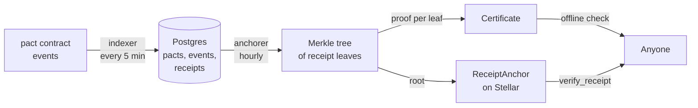

# Pactwright-studio: details moved from the README

These sections were in the README. They moved here, unchanged, so the README stays short.
The [documentation site](https://pactwright.github.io/docs/) covers the same ground for readers; this file keeps the repository's own copy.

### How a receipt becomes provable

Anchoring each receipt in its own transaction would be expensive, so Studio batches many receipts into one Merkle tree and anchors only its root. A single small transaction covers hundreds of receipts, and every receipt in it can still be proven on its own.



### Trust and privacy

**You do not have to trust Studio.** A certificate is a receipt plus a Merkle proof: recompute the root yourself and compare it with the anchored root, or call `verify_receipt` on the `ReceiptAnchor` contract directly. Studio only saves you the work.

**If Studio goes down, nothing stops.** The money is never in Studio — the contract holds and moves it. Pacts keep working, and already-issued certificates stay verifiable against the anchored roots.

**Pact data is public by design**, because the chain it comes from is public. The merchant and principal dashboards have no sign-in yet, so do not put private data in them before that lands.

## 📊 Anchoring and dashboards

Batch 1 anchored **9 receipts** in one transaction, signed by the `ReceiptAnchor` admin key: [`be51068e…`](https://stellar.expert/explorer/testnet/tx/be51068eea65b8f47799253ca45bd5e5d9c014d7cae0b873f19150658d8edfb0). Every proof in it verifies offline and with ReceiptAnchor's own `verify_receipt`.

Who sees what:

| Who | Page | What they see |
|---|---|---|
| **Anyone** | `/` | Pact lookup and the latest pacts |
| **Anyone** | `/pact/<id>` | The public timeline of one pact, with Stellar Expert links per network (`/pact?id=…` redirects here, so lookup works without JavaScript) |
| **Anyone** | `/verify` | Paste a certificate and check its proof offline, then check the anchored root on-chain |
| **Sellers** | `/merchant` | Revenue, refund and dispute rates, cost per route |
| **Agent owners** | `/principal` | Budgets and live pacts for each agent they run |
| **Operators** | `/api/ops/health` | Sponsor balance, indexer lag, pending certificates, verifier error rate |

Run the live check yourself (it sends real `anchor_batch` transactions):

```bash
DATABASE_URL=… ANCHORER_SECRET=S… STELLAR_NETWORK=testnet STELLAR_RPC_URL=https://soroban-testnet.stellar.org \
PACT_CONTRACT_ID=CDUXJJUNYFILEYHE3LITANJEKCDFERNAABOSG75OWATFVM776BCMFEV6 \
RECEIPT_ANCHOR_ID=CAEO5GBC3ULRC5RYBSCSOXLNXHU2HZAHNW5HY5LZM3DIPFMX357ILNJ2 INDEX_START_LEDGER=… \
pnpm --filter web live:testnet
```

## ⚙️ Supported Versions & Compatibility

Studio is a Next.js app plus an indexer, so the thing that actually constrains a deployment is the Node and pnpm pair the workspace pins, and the Stellar network the anchorer signs for. Both are read from the manifests, not from memory:

| Item | Pin | Read from |
|---|---|---|
| Node.js | `>=24` (CI uses `.nvmrc`) | root `package.json` `engines`, `ci.yml` |
| pnpm | `10.34.7` | root `package.json` `packageManager` |
| Next.js | `^16.0.0` | `apps/web/package.json` |
| React | `^19.2.0` | `apps/web/package.json` |
| `@stellar/stellar-sdk` | `^16.4.1` | `apps/web/package.json` |
| `pg` | `^8.16.0` | `apps/web/package.json` |
| TypeScript | `^5.9.0` | `apps/web/package.json` |
| Vitest / Playwright | `^4.0.0` / `^1.56.0` | `apps/web/package.json` |

### What "Supported" means here

`Supported` means the gate runs on every push and pull request to `main`: [`ci.yml`](../.github/workflows/ci.yml) installs with `--frozen-lockfile`, then `pnpm typecheck` and `pnpm test`; [`e2e.yml`](../.github/workflows/e2e.yml) applies the migrations, seeds data, builds the app and runs the Playwright specs; [`migrations.yml`](../.github/workflows/migrations.yml) checks the schema files; [`roadmap-check.yml`](../.github/workflows/roadmap-check.yml) fails a pull request that does not touch `ROADMAP.md`.

The network side is verified by hand, not continuously: the anchoring figures below were produced against Stellar testnet on 2026-10-29 with deployed contract addresses ([`DEPLOYMENTS.md`](https://github.com/Pactwright/Pactwright-contracts/blob/main/DEPLOYMENTS.md)). A row marked `Untested` has neither CI coverage nor a manual run, and `Not implemented` means the code refuses rather than guesses.

## 📊 Measurements

Every figure in this README is recorded somewhere you can open, not remembered:

- **Anchoring**: batch 1's transaction is linked above; `verify_receipt` on the deployed `ReceiptAnchor` confirms each leaf in it.
- **Tests**: 62 unit tests across 12 suites, measured 2026-10-30 with `pnpm test`; the 3 Playwright end-to-end specs run in [`e2e.yml`](../.github/workflows/e2e.yml), not locally.
- **Testnet purchase**: the pact the hosted verifier judged with its real model is [`40725564…5c55`](https://pactwright-studio.vercel.app/pact/4072556402d709463f7cb888a4a9e03b061d906f0b7ca5c49ebb2eec4e7d5c55).
- **Network figures** for the pacts below come from the [Pactwright-Kit testnet e2e](https://github.com/Pactwright/Pactwright-Kit/tree/main/e2e/testnet) report, not from Studio.

### Built on

| Project | What Studio uses | How |
|---|---|---|
| [Accensa](https://github.com/accensa) | `ReceiptAnchor` (Merkle roots on-chain), `RefundVault` events, indexer patterns | Same Merkle format; anchors to `ReceiptAnchor` v0.2.0; indexes `RefundVault` refunds |
| [Tollcraft](https://github.com/Tollcraft) | Contract cost reports | Cost per route in the merchant dashboard |
| [Pollar](https://docs.pollar.xyz) | Seller storefronts | `templates/pollar-studio`, built with the public SDK only |
| [Witness](https://github.com/fabian416/witness) | Verdict envelopes | Stored with each pact (`verdicts` table) |

### What the MIT license means for you

| You may | You must | You get no |
|---|---|---|
| Use the code in open or closed-source projects, commercially or not | Keep the copyright notice and the license text in every copy or substantial portion | Warranty of any kind |
| Copy, modify, merge and publish it | | Liability from the authors for any loss |
| Distribute, sublicense and sell copies | | |
| Run your own Studio for your own pacts | | |

Running your own Studio doesn't make its certificates any less verifiable. Proofs check against the on-chain root, not against whoever hosts the page.

### Third-party code and licenses

| Component | How it is used | License |
|---|---|---|
| [Next.js](https://www.npmjs.com/package/next) | The web app | MIT |
| [React](https://www.npmjs.com/package/react) | UI | MIT |
| [node-postgres (`pg`)](https://www.npmjs.com/package/pg) | Database access | MIT |
| Vitest, Playwright, TypeScript | Development and tests only, not shipped | MIT / Apache-2.0 |
| Accensa `ReceiptAnchor` format | Merkle tree format; Studio anchors to the deployed contract but includes none of its code | MIT |

Pollar Studio has no license file, so none of its code is used. The storefront template uses only the public Pollar SDK. Every project Pactwright builds on is credited in [NOTICE](../NOTICE).

### The other Pactwright repositories

| Repository | License | Why |
|---|---|---|
| [Pactwright-contracts](https://github.com/Pactwright/Pactwright-contracts) | MIT | Short, permissive terms |
| [Pactwright-Kit](https://github.com/Pactwright/Pactwright-Kit) | Apache-2.0 | It vendors Witness core, which is Apache-2.0, and adds an explicit patent grant |
| Pactwright-studio (this repo) | MIT | Same terms as the contracts |

### Contributing under this license

By opening a pull request, you agree that your contribution is licensed under the same MIT license as the rest of the repository. There is no separate contributor license agreement.
